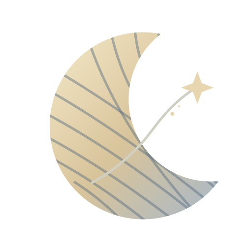

  

  # moon-weave

  **织月 · 拾一缕灵感，织万千可能**

  *Gather scattered thoughts. Weave them into worlds.*

  一个收藏灵感、尝试奇思、让想法逐渐成形的作品集。

  每个应用都是独立的尝试，各有自己的语言、结构与故事。

---

## 🌙 关于这里

> 月本无丝，因念成织。  
> 偶得一缕灵光，便试着将它织成可以触碰的模样。

**moon-weave（织月）** 是一个由 AI 辅助创作的应用集合。

一个念头，可能成为一个小工具、一场交互实验，或一个完整的 Web 应用。

这个仓库只负责为它们提供一个共同的归处。

## ✨ 作品目录

| 项目 | 一句话介绍 | 技术栈 |
| --- | --- | --- |
| [`nginx-insight`](./nginx-insight/README.md) | 从访问日志，看见站点的每一次连接。 | Python+Flask+ECharts |
| [`agent-session-hub`](./agent-session-hub/README.md) | 把散落在终端里的对话，整理成你的开发记忆。 | Python 标准库 + SQLite + 原生 JavaScript |

## 🌱 创作约定

- **一念一作**：每个想法可以成为一个独立项目，不必强行整合。
- **不拘一格**：按问题选择语言、框架与工具，不为统一而统一。
- **AI 为梭**：借助 AI 加速探索与实现，但保留自己的判断、验证和打磨。
- **小而完整**：优先让想法成为可以运行、可以体验的作品。
- **留下痕迹**：在各项目中记录缘起、用法、取舍和后续方向。

## 🚀 如何探索

1. 从上方的[作品目录](#-作品目录)选择感兴趣的应用。
2. 进入对应子目录，阅读它自己的 `README.md`。
3. 按照该项目的说明安装依赖、配置环境并运行。

不同项目的启动方式可能完全不同，请以各自的文档为准。

## 📜 许可

仓库的许可范围以根目录 `LICENSE` 及各子项目的许可声明为准。不同项目可能包含具有独立许可证的第三方依赖或资源。

---

*不必摘月，且把月光织成梦。*

**moon-weave · 织月**

